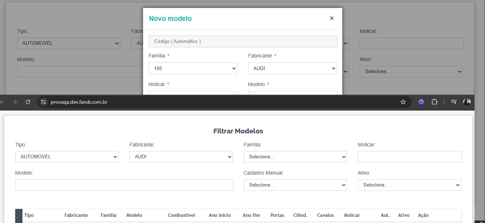
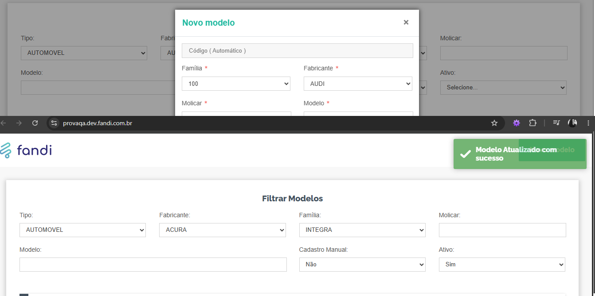
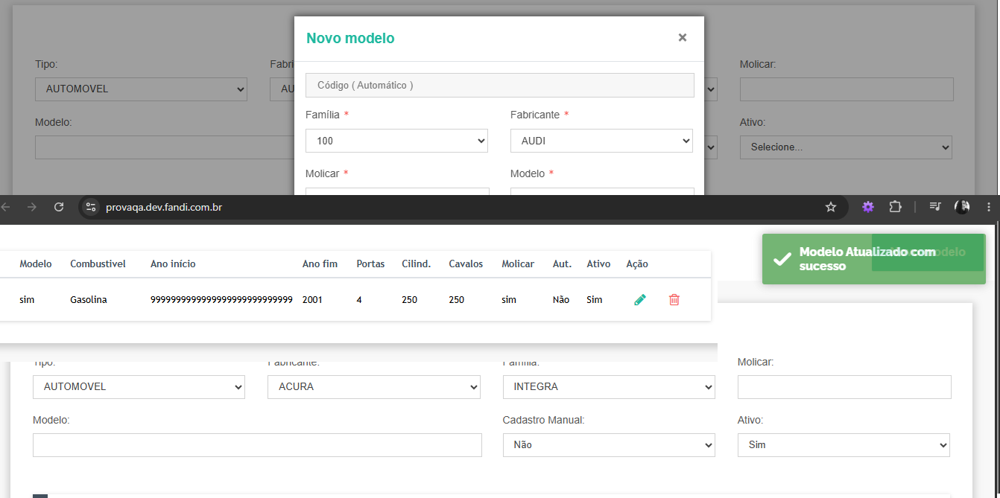
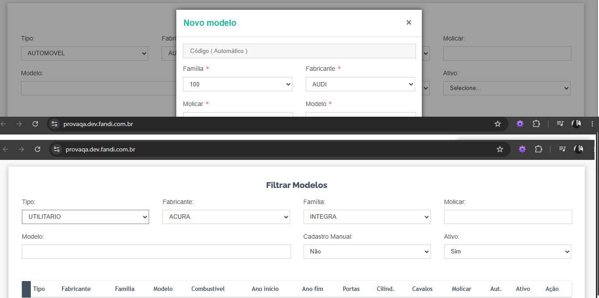
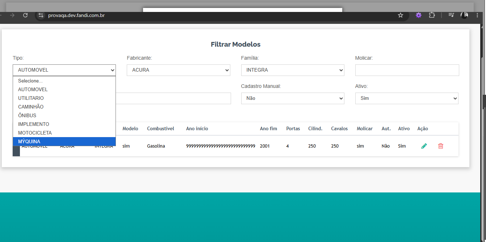
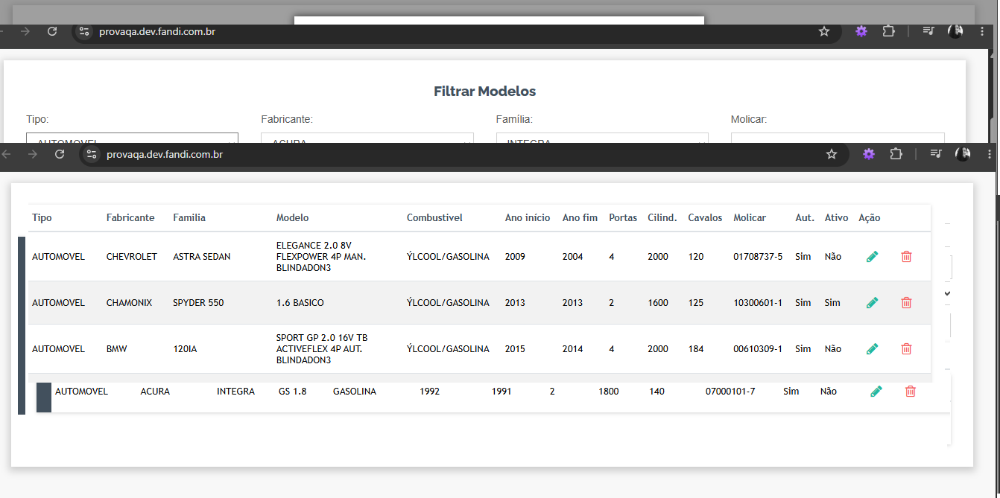
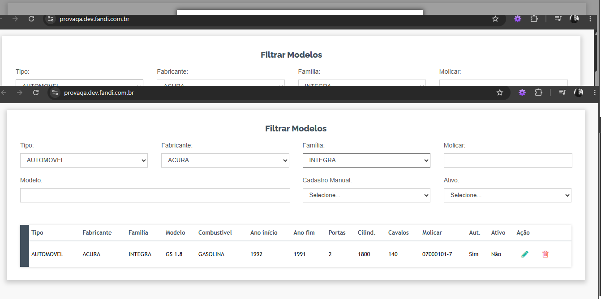

# Relatório de Bugs - ProvaCar

Ambiente: provaqa.fandi.com.br
Navegador: Chrome, 156.0.8078.80 (Versão oficial) 64 bits (cohort: Stable)
Data do teste: 05/11/2026

---

## BUG001 - Ano inicial e ano final aparecem invertidos na edição
**Severidade:** Alta
**Passos:**
1. Acessar provaqa.fandi.com.br e clicar em iniciar
2. Localizar o registro de automovel acura
3. Clicar em editar
4. Observar os campos de ano inicial e ano final
**Resultado obtido:** o valor do ano inicial aparece no campo ano final e o do ano final aparece no campo ano inicial
**Resultado esperado:** cada campo exibir o seu próprio valor
**Evidência:**

---

## BUG002 - Sistema permite cadastrar o mesmo veículo duas vezes
**Severidade:** Média
**Passos:**
1. Acessar o sistema e clicar em iniciar
2. Cadastrar um veículo com auttomovel/ acura/integra /ano inicial/ano final
3. Cadastrar novamente um veículo com exatamente os mesmos dados
**Resultado obtido:** o segundo cadastro é aceito e aparece mensagem de sucesso
**Resultado esperado:** o sistema bloquear o cadastro e informar que o veículo já existe
**Evidência:**

---

## BUG003 - Campo ano final aceita valores absurdos sem limite
**Severidade:** Média
**Passos:**
1. Acessar o sistema e clicar em iniciar
2. Iniciar o cadastro de um veículo
3. Preencher marca, modelo e ano inicial com dados válidos
4. Preencher o ano final com 999999999
5. Clicar em salvar
**Resultado obtido:** o registro é salvo com sucesso com o ano final 999999999
**Resultado esperado:** o sistema limitar o campo a 4 dígitos e exibir mensagem de ano inválido
**Evidência:**

---

## BUG004 - Filtro retorna resultados apenas para o tipo "Automóvel"
**Severidade:** Alta
**Passos:**
1. Acessar provaqa.fandi.com.br e clicar em iniciar
2. No filtro de tipo de veículo, selecionar "Automóvel"
3. Observar a lista de marcas/modelos
4. Repetir o passo 2 selecionando, um por vez: Utilitário, Caminhão, Ônibus, Implemento, Motocicleta e Máquina
**Resultado obtido:** com "Automóvel" os resultados são exibidos normalmente. Com os outros 6 tipos, nenhuma marca ou modelo é listado 
**Resultado esperado:** o filtro exibir marcas e modelos de todos os 7 tipos de veículo, já que o sistema se baseia na tabela Molicar
**Observação:** teste feito nos outros 6 tipos
**Evidência:**

---

## BUG005 - Erros de ortografia / caracteres incorretos na interface
**Severidade:** Baixa
**Passos:**
1. Acessar provaqa.fandi.com.br e clicar em iniciar
2. Abrir o filtro "tipo" e observar a opção "mýquina"
3. Selecionar o tipo "Automóvel" e observar a coluna "Combustivel" da lista
**Resultado obtido:**
- A opção do filtro aparece escrita como "mýquina"
- Os veículos a álcool aparecem com "ÝLCOOL/GASOLINA" na coluna Combustivel
**Resultado esperado:**
- A opção escrita como "máquina"
- O combustível escrito como "ÁLCOOL/GASOLINA"
**Observação:** o caractere "Ý" aparece no lugar de "Á", o que indica possível problema de codificação de caracteres (encoding)
**Observação:** Outras palavras sem acento nessa tela como "combustivel (cabeçalho)", "familia (cabeçalho)", "AUTOMOVEL (coluna Tipo)", "1.6 BASICO (modelo)".
**Evidência:**

---

## BUG006 - Alterações não persistem ao recarregar a página
**Severidade:** Média
**Passos:**
1. Acessar o sistema e clicar em iniciar
2. Cadastrar ou editar um veículo e excluir outro
3. Recarregar a página (F5 ou botão de recarregar do navegador)
**Resultado obtido:** a tela volta ao início, o veículo cadastrado/editado perde as alterações e o veículo excluído reaparece
**Resultado esperado:** os dados serem mantidos após recarregar
**Evidência:**

---

## BUG007 - Sistema aceita ano final menor que o ano inicial
**Severidade:** Média
**Passos:**
1. Acessar o sistema e clicar em iniciar
2. Iniciar o cadastro de um veículo
3. Preencher marca e modelo
4. Preencher o ano inicial com 2020 e o ano final com 2010
5. Clicar em salvar
**Resultado obtido:** o registro é salvo com sucesso
**Resultado esperado:** o sistema bloquear o cadastro e informar que o ano final não pode ser menor que o ano inicial
**Evidência:**

